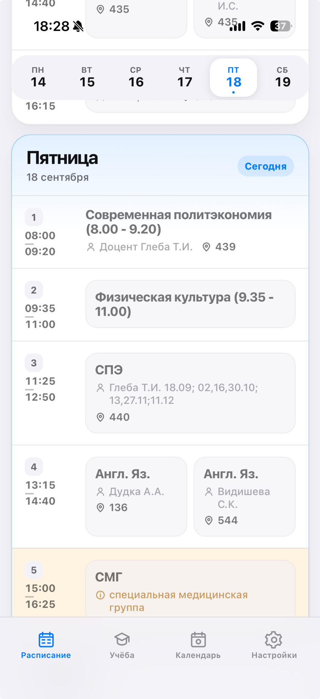
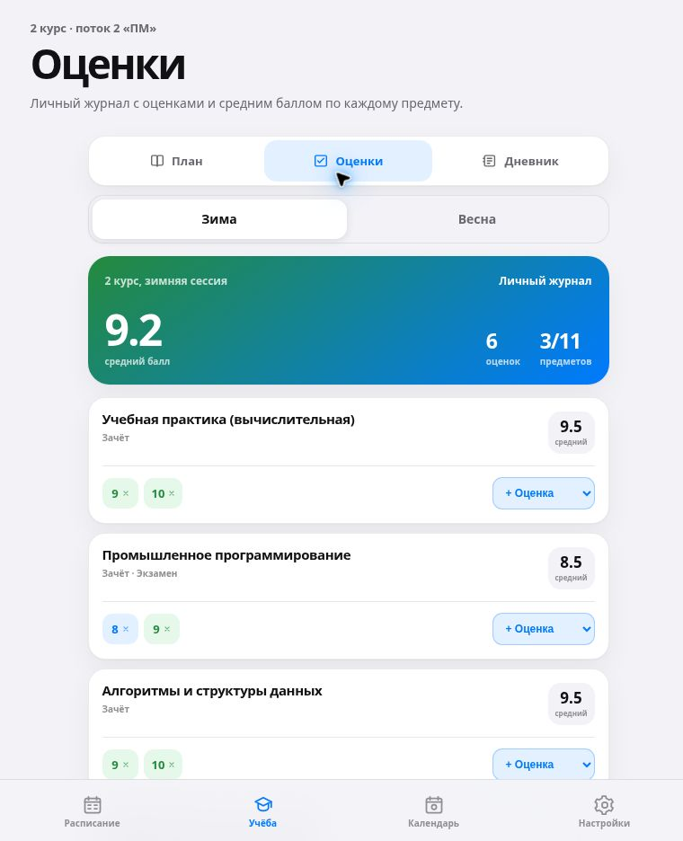
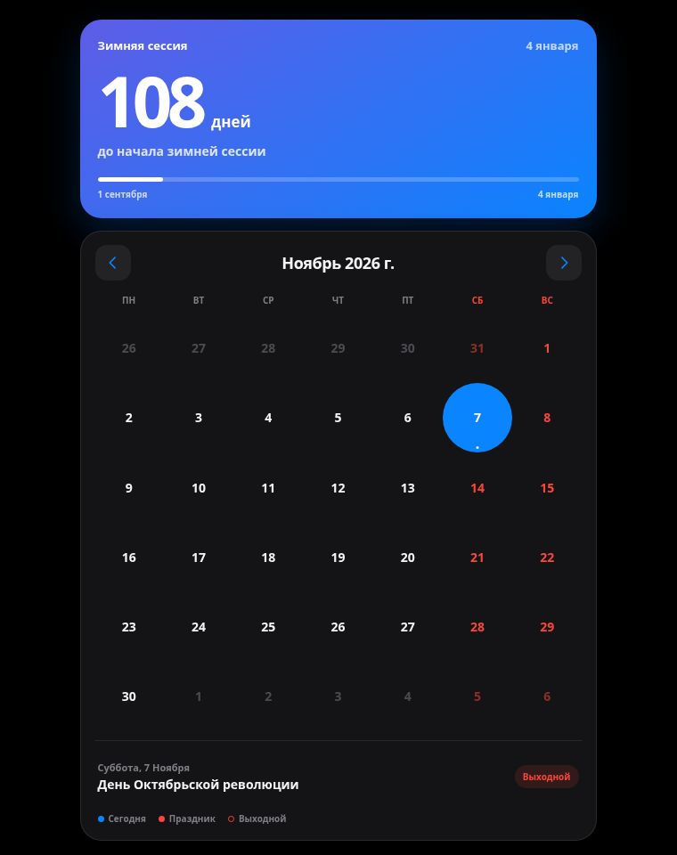
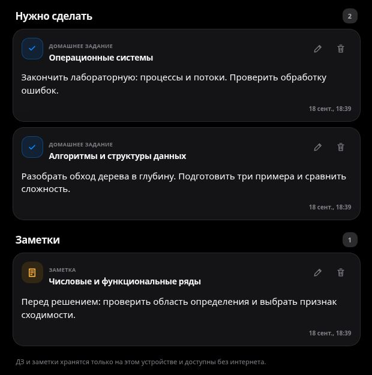

# Pario

### Твоя неделя. Твой ритм.

Студенческий планер, в котором расписание, домашние задания и оценки всегда под рукой — даже без интернета.

**[Открыть Pario ↗](https://bsu-schedule-pwa.netlify.app)** · **[English](README.md)** · **[Что нового](CHANGELOG.md)** · **[Предложить идею](https://github.com/AlexKweb/pario-student-planner-pwa/issues)**

PWA · Работа офлайн · Интерфейс для телефона

  

Pario на iPhone · настоящий скриншот приложения

## Учебный день, в котором проще разобраться

Расписание университета часто живёт в таблице. Чтобы посмотреть сегодняшние пары с телефона, нужно снова открыть файл, найти свою группу и нужную строку.

Pario превращает это в удобную неделю на одном экране. Открываешь приложение с экрана «Домой», видишь сегодняшние пары и ведёшь свои ДЗ, заметки и оценки рядом с расписанием.

## Что уже работает

| Задача | Возможности Pario |
| --- | --- |
| **Найти следующую пару** | Вся неделя с понедельника по субботу, отметка «Сегодня», автоматическая прокрутка и кнопка возврата к сегодняшним парам. |
| **Понять, сколько прошло** | Время с начала пары с плавным индикатором прогресса и обратный отсчёт до следующего занятия. |
| **Видеть своё расписание** | Выбор группы, одной или обеих подгрупп, отдельное оформление лекций и практик. |
| **Не потерять задания** | Дневник по предметам: ДЗ и заметки, необязательные сроки, редактирование и отметка выполнения. |
| **Следить за результатами** | Личные оценки от 1 до 10 и средний балл по каждому предмету. |
| **Планировать заранее** | Календарь с выходными и праздниками Беларуси, отсчёт до сессии, учебный план зимней и весенней сессий. |
| **Настроить под себя** | Светлая, тёмная и системная темы, компактные карточки и сохранение настроек. |
| **Пользоваться без сети** | После успешной онлайн-загрузки приложение и расписание сохраняются для работы офлайн. Личные записи остаются на устройстве. |

## Как это выглядит

<table>
  <tr>
    <th>Личные оценки · светлая тема</th>
    <th>Календарь · тёмная тема</th>
  </tr>
  <tr>
    <td valign="top"></td>
    <td valign="top"></td>
  </tr>
</table>

**Домашние задания и заметки по предметам**

  

На скриншотах настоящий интерфейс приложения. Оценки и записи дневника придуманы для демонстрации. Даты и отсчёты соответствуют моменту съёмки; [подробнее о скриншотах](assets/README.md).

## Установить на iPhone

1. Открой **[Pario в Safari](https://bsu-schedule-pwa.netlify.app)** с подключением к интернету.
2. Нажми **«Поделиться» → «На экран Домой»** и подтверди добавление.
3. Запускай приложение с новой иконки. После завершения кэширования расписание доступно без сети.

В окне установки приложение пока может называться **«Расписание»**. Pario — название продукта; единое оформление внутри приложения пока записано как идея для развития.

## Быстрый первый экран

Телефон не скачивает исходную таблицу при каждом открытии. Отдельный процесс обновления заранее разбирает и проверяет расписание, после чего оно включается в сборку приложения. Service worker сохраняет приложение и данные для следующих запусков.

- **Ежедневная проверка источника:** запланирована на **22:00 по Минску (19:00 UTC)**. GitHub Actions может запустить её с задержкой.
- **Защита от неудачных обновлений:** ошибка скачивания, проверки или сборки оставляет опубликованную рабочую версию расписания.
- **Понятная актуальность:** время последней успешной проверки хранится отдельно от времени изменения исходного файла.
- **Личные данные на устройстве:** оценки, ДЗ, заметки и настройки сохраняются локально; синхронизации через аккаунт нет.
- **Защита при сохранении:** если запись дневника не сохранилась, черновик остаётся в форме. Достижение лимита не удаляет старые записи.

**Стек:** React · TypeScript · Vite · Workbox / PWA · Vitest · GitHub Actions · Netlify.

Подробнее о решениях, проверках и компромиссах — в **[архитектуре](docs/architecture.md)** и **[описании данных и офлайн-режима](docs/data-and-offline.md)**. Технические документы пока на английском.

## Для кого доступно сейчас

Pario сейчас поддерживает **БГУ, 2 курс «Прикладной математики», поток 2, группы 5–7**. По умолчанию выбраны группа 7 и обе подгруппы. Интерфейс приложения — на русском, документация проекта — на русском и английском.

Расписание рассчитано на **3 семестр 2026–2027 учебного года**. Учебный план включает предметы зимней и весенней сессий. Это независимый студенческий проект, не официальный сервис университета. Окончательный источник расписания и изменений — университет.

Для первого открытия нужен интернет. Офлайн используется последняя сохранённая версия, а для получения новых выпусков расписания необходимо подключение. Личные записи **привязаны к этому браузеру и устройству**: они не появятся на другом телефоне и могут потеряться при очистке данных сайта. Резервную копию оценок и дневника можно сохранить и восстановить вручную в настройках (JSON, без интернета).

## Что дальше

В новой навигации отдельный **«Планер»** займёт центральное место:

**Расписание · Учёба · Планер · Календарь · Настройки**

Сценарии Планера ещё прорабатываются. В текущем приложении четыре основных раздела, а дневник уже доступен внутри «Учёбы».

**[Планы развития](ROADMAP.md)** · **[История изменений](CHANGELOG.md)**

## Об этом репозитории

Здесь собраны описание Pario, скриншоты, документация, планы и обратная связь. **Исходный код приложения хранится в приватном репозитории и сюда не включён.** Клонирование этого репозитория не устанавливает приложение; попробовать его можно по ссылке выше.

Нашёл ошибку или придумал улучшение? **[Создай issue](https://github.com/AlexKweb/pario-student-planner-pwa/issues)** — можно писать на русском или английском. Исправления документации принимаются через pull request.

Если Pario полезен тебе, **звезда** поможет другим узнать о проекте.

## Резервная копия

В настройках доступны ручной экспорт оценок, домашних заданий и заметок в JSON
и восстановление на другом устройстве. Файл проверяется перед импортом;
замена текущих записей требует подтверждения. Копия не зашифрована,
поэтому храните её в безопасном месте. Автоматической синхронизации нет.
