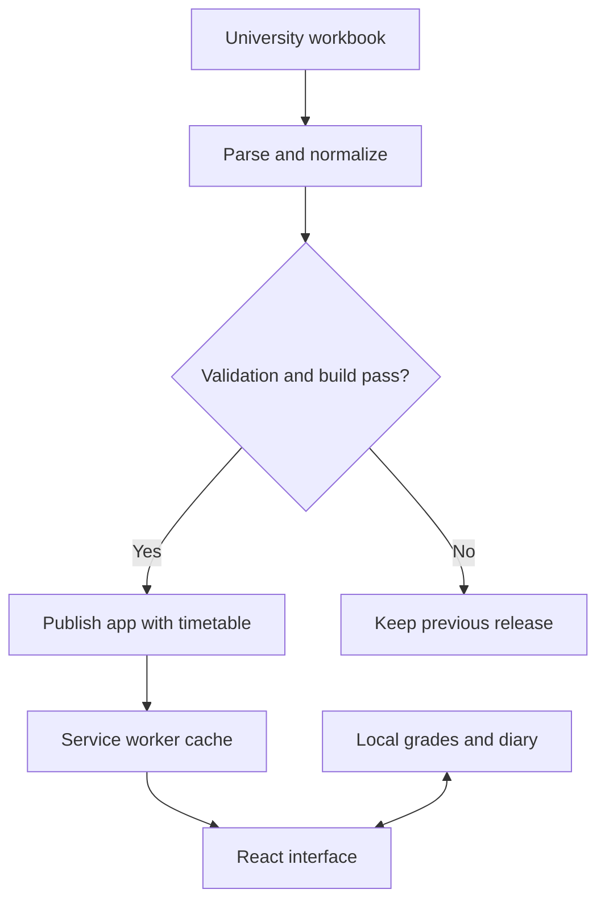

# Architecture

[English overview](../README.md) · [Обзор на русском](../README.ru.md) · [Data and offline behavior](data-and-offline.md)

Pario is a static React application with a separate timetable preparation pipeline.
The first useful screen reads bundled data. Opening the app does not wait for the
university spreadsheet or an application API.

## From source to screen

The scheduled process checks the source independently of whether the user opens
the app. Successful checks update freshness metadata, even when the workbook
contents have not changed. The resulting app release carries the timetable and
its check timestamp together.

## Responsibilities and dependency direction

The dependency direction is **presentation → application → domain**. The
spreadsheet parser and browser adapters sit at the boundaries; the domain does
not depend on React, browser storage, XLSX parsing or hosting.

| Layer | Owns | Deliberately avoids |
| --- | --- | --- |
| **Domain** | Schedule selection and timing, Minsk dates, calendar rules, study-plan models, grade averages, diary validation and ordering | React components, network calls and browser APIs |
| **Application** | Access to bundled schedules, preference/grade/diary persistence, service-worker update coordination | Visual layout and duplicated subject data |
| **Presentation** | Pages, focused components, navigation, clock/scroll hooks and theme tokens | Reimplementing date rules, averages or persistence validation inside components |
| **Data preparation** | Workbook parsing, merged-cell handling, group discovery and validated catalog generation | Runtime dependence on the university source |

Study-plan data is separate from its table UI. Grades and diary entries reference
known subjects rather than inventing a second subject list. User preferences,
grades and diary entries have separate versioned storage formats and validation.

ESLint enforces the domain and application import boundaries. Shared calendar
helpers validate dates and move between calendar days without assuming that
every local day lasts exactly 24 hours. Diary ordering and deadline state stay
outside presentation components.

## Local state and navigation

A shared persistence boundary writes an edit before publishing the new value to
the interface. Stores belong to mounted views rather than mutable global state;
reading or subscribing never writes defaults back to storage. An unreadable or
unsupported record format is distinguished from a missing record, and an edit
must retry a failed read before it can replace stored data.

Forms receive the save result. A failed diary save keeps the draft available to
edit or retry. Record limits reject additions with feedback instead of silently
evicting older entries. These safeguards do not provide backup or device sync.

One browser-history adapter coordinates the main sections and Study views. It
handles in-app navigation, direct hash changes and the browser's back/forward
buttons so that the URL and visible view stay aligned.

## Decisions and tradeoffs

| Decision | Why | Tradeoff |
| --- | --- | --- |
| Bundle the timetable with the app | First render can use data immediately; the same data works offline | A source update requires a new app release |
| Cache the app with Workbox | Repeat visits can load without the network | Offline users keep their cached release until they reconnect |
| Store personal entries locally | No account setup or server dependency for homework and grades | No cross-device sync or backup; clearing storage can remove records |
| Use a single Minsk schedule clock | Classes and day boundaries stay consistent with the university timetable | Schedule time is intentionally different from a travelling user's local clock |
| Validate before replacing data | Unexpected spreadsheet changes must not publish a partial timetable | A failed update keeps older data until the problem is resolved |
| Keep holidays in the app | Calendar use does not depend on a holiday API | Year-specific transfers must be maintained explicitly |

## Parser safeguards

The source is a formatted workbook rather than a clean API. The parser discovers
group and subgroup headers, interprets merged cells, preserves shared lessons,
handles subgroup differences and uses effective lesson times. Date-specific
entries are shown only in their relevant week.

Workbook traversal, lesson-time validation and subgroup interpretation are
separate responsibilities. Impossible or reversed time ranges are rejected.
Regression tests build a synthetic workbook to exercise merged cells, reordered
group headers, shared rooms, distinct subgroups and missing or incomplete groups.

All configured groups are generated before the catalog is replaced. Structural
and minimum-content checks reject empty or incomplete output. Generation writes
to a temporary file before replacing the working catalog; the update workflow
then runs the quality gates before committing the result.

Lecture/practice classification follows conventions in the workbook, not an
authoritative structured field. Upstream formatting changes can therefore need a
parser adjustment. Validation reduces this risk; it cannot prove every source
entry is semantically correct.

## Quality checks

The application repository uses strict TypeScript, ESLint, Vitest, schedule-data
validation, icon integrity checks and a production build. Tests cover domain
rules and boundaries such as calendar transitions, storage read/write failures,
record limits, browser navigation, service-worker retry scheduling and complete
synthetic-workbook ingestion. See the [changelog](../CHANGELOG.md) for dated
engineering changes.

The public repository contains documentation only. It does not publish the
private test suite or display a build badge that readers cannot verify. Test
counts and performance claims are intentionally omitted unless accompanied by a
dated, reproducible measurement.

## Technology

| Area | Technology |
| --- | --- |
| Interface | React, TypeScript |
| Build | Vite |
| Offline delivery | vite-plugin-pwa, Workbox |
| Verification | Vitest, ESLint, TypeScript |
| Scheduled checks and CI | GitHub Actions |
| Static hosting | Netlify |

This describes the current implementation. It is not a source-code distribution.
